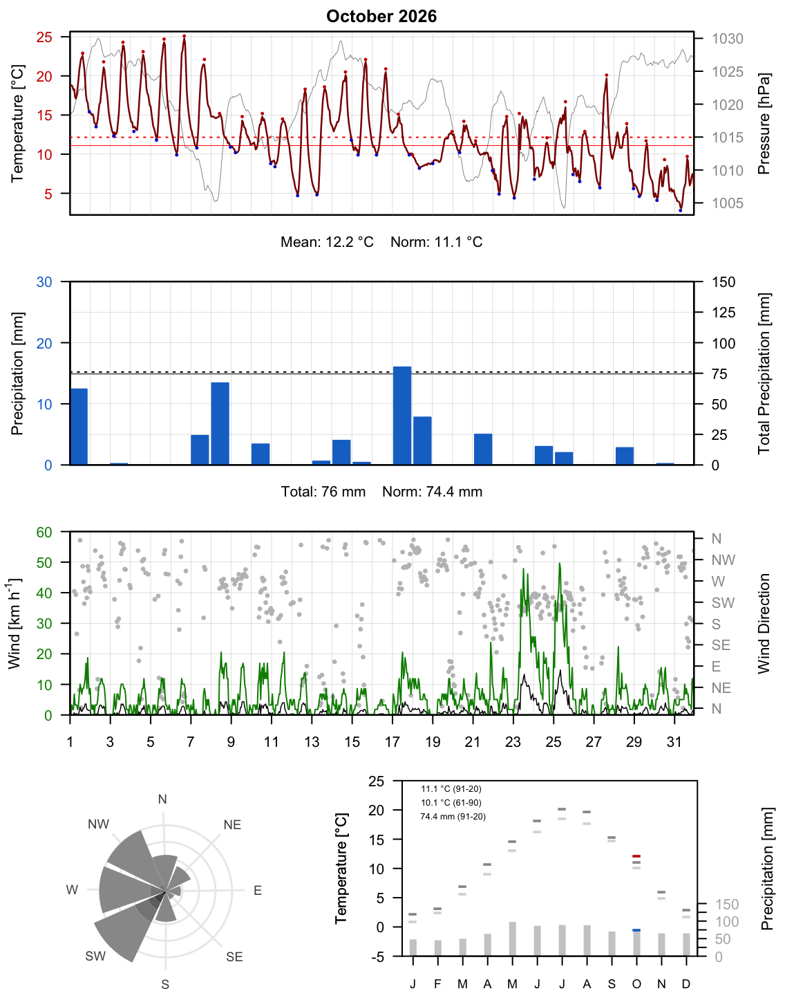

# Weather Station Data – Monthly Visualization

## Project Description

This R script provides a monthly overview and visualization of meteorological measurements from a weather station.

The analysis is based on an example dataset containing hourly measurements from a **Davis Vantage Pro 2 weather station** located in Reinach, Basel-Landschaft, Switzerland.

## Features

The script generates a monthly overview, including:

- **Temperature [°C]:** Hourly temperature, daily maximum and minimum temperatures, and monthly mean temperature.
- **Atmospheric Pressure [hPa]:** Hourly pressure measurements.
- **Precipitation [mm]:** Daily precipitation totals and monthly accumulated precipitation.
- **Wind [km/h]:** Mean wind speed, gusts and wind direction.
- **Wind Rose:** Graphical representation of wind direction frequencies.
- **Climate Comparison:** Comparison of monthly temperature and precipitation measurements with climatological reference values from Basel-Binningen (MeteoSwiss).

## Example Data

An included example dataset with hourly meteorological measurements demonstrates the functionality of the script.

The dataset contains the following variables:

- Date and time
- Temperature, daily maximum and minimum temperature [°C]
- Relative humidity [%]
- Dew point [°C]
- Atmospheric pressure [hPa]
- Mean wind speed and wind gusts [km/h]
- Wind direction [degrees]
- Precipitation [mm]

## Requirements

- R packages used: ggplot2, windRose, climaemet, grid, gridBase

## Usage

1. Download the repository.
2. Open the RStudio project.
3. Open `Monthly_Overview.R`.
4. Adjust the month and year in the **Settings** section, and choose a MeteoSwiss station for climate comparison.
5. Run the entire script.

## Example Output

